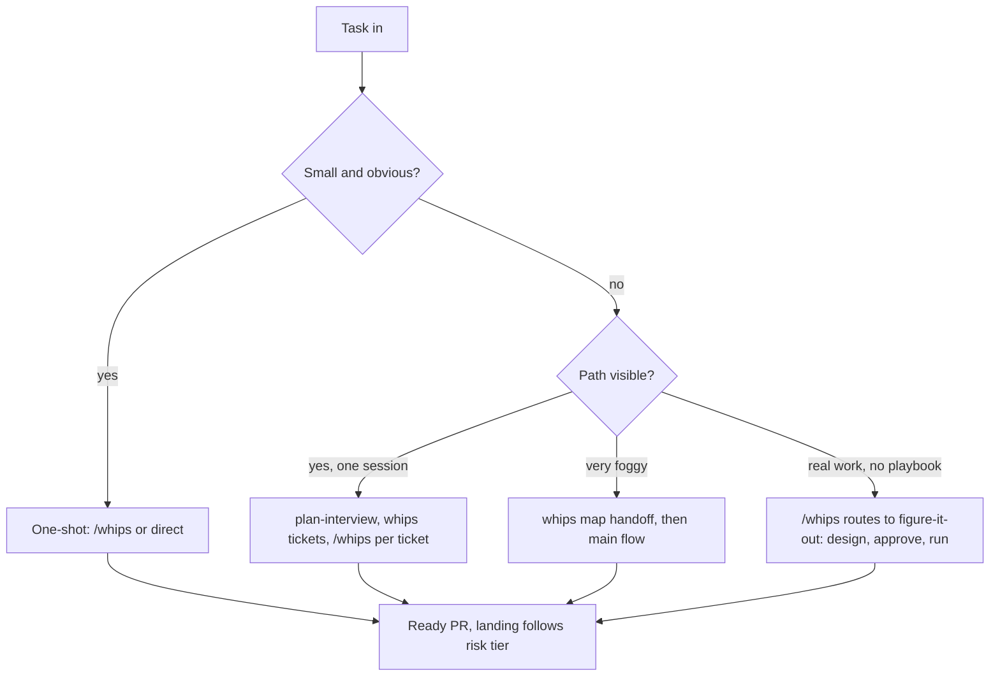
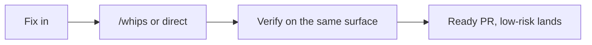
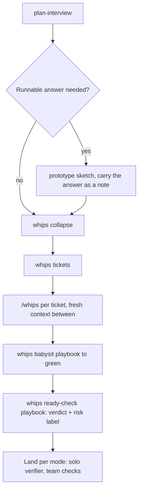
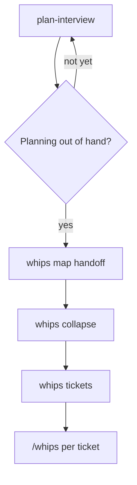
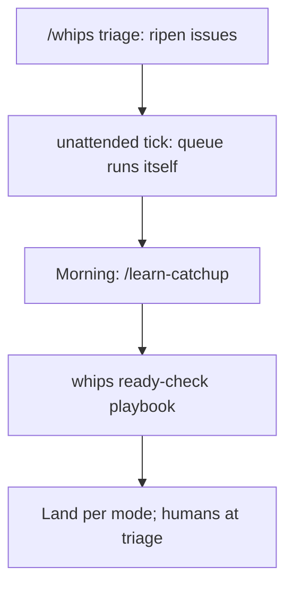
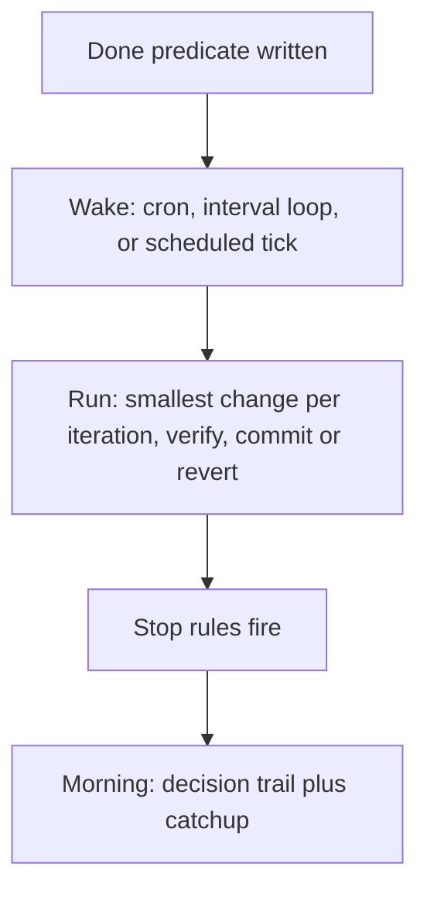

# Cookbook: flows and recipes

Each recipe is one complete workflow: when to use it, which skills to type in order, and its diagram. Diagrams render in preview. The interactive router stays in [`SKILL.md`](./SKILL.md); this book is for reading directly. For the big picture, read [FACTORY.md](./FACTORY.md).

Conventions in every diagram: boxes are skills you type (`/whips`) or playbooks whips runs, diamonds are your decisions, dashed arrows are escalations.

## 0. Which path (master map)

Thin fog skips the hops: when one interview round settles it in a fresh context, `/whips` drives through interview, spec sketch, and tickets inline (drive-through policy) instead of changing sessions.

## 1. Tiny fix one-shot

When: one line, a symlink, a config flag, a copy typo.

No interview: it costs more than the work.

Example: dead `public/storage` symlink. Type into `/whips`: "re-link public/storage to storage/app/public, verify with ls -l". One low-risk PR, lands directly.

## 2. Idea to ship (main flow)

When: an idea to build within one session or a few tickets.

One unbroken window for grill through tickets; each whips run starts fresh. Thin fog skips the hops via drive-through (recipe 0). Gate to a dedicated session only when the fog needs its own window.

Spec and tickets already exist: skip straight to `/whips` per ticket, blockers-first along the frontier, fresh context (and `/clear`) between tickets. Tracker issues with `ready-for-agent`: `/whips` intake while you watch, unattended tick while you sleep.

Example: "skeleton loading on the Menu page". `plan-interview` decides one reusable Skeleton component (not one per page), whips collapse, whips tickets (3 tickets: component, use in Menu, e2e proof), `/whips` per ticket.

Upstream split: pstack owns automation and shipping, Matt owns planning ideas ([upstream-map.md](../../../docs/upstream-map.md)).

## 3. Foggy to map

When: greenfield or a giant feature with no visible path.

Never start with a map: a map and tickets you turn out not to need are self-made garbage. And thin fog never reaches it: drive-through inside whips handles what one interview round settles.

Example: "migrate media uploads to S3". Start `plan-interview`; planning sprawls into cost, rollback, seeders, so run the whips map handoff → map of decision tickets → whips collapse → tickets → whips.

## 4. Overnight unattended

When: sleep while the queue resolves itself.

Alternative for one long unattended run: `/whips` with a checkable predicate plus budget, not a queue. Execute stays `/whips` only. With a clear predicate, run the [autonomous-run](../whips/playbooks/autonomous-run.md) playbook: predicate, wake, smallest change per iteration, decision trail, never relax the predicate.

## 4b. Overnight trust contract

When: the queue runs while you sleep (#214).

Done means: a falsifiable predicate written before the run, checked on the real artifact after each iteration. Stop rules: the predicate holds, the iteration or hour budget runs out, or no approach is left (write what was tried and hand back). Never relax the predicate to declare victory. Work lands per risk tier; humans decide at triage and on irreversible actions. Wake wording stays harness-neutral: cron, an interval loop, or a scheduled tick. Morning audit reads the decision trail (`.scratch/whips/<run>/decisions.tsv`) plus `/learn-catchup`.

## Advanced (off the main flow)

These ship but sit outside the COOKBOOK and FACTORY main path; reach for them only when the task names them. Formal proof: `/create-formal-verification`, `/maintain-formal-verification`. Skill authoring: `/craft-agent-docs` via the authoring playbook. Optional repo layout: the whips `ts-modules` playbook. Learning gate: `/learn-diff-gate` when you must prove you understand a change.

## Trigger catalog

Each row names the situation, the skill or playbook, and the entry line. The router in [SKILL.md](SKILL.md) holds the short list; this catalog holds the rest.

1. Prose smells of AI filler: `review-unslop`, then `review-prose` for the rewrite.
2. Comment-only cleanup on a PR: `review-nocomment` via `/whips`.
3. Scope or seam unclear before building: `craft-architect`.
4. Adversarial second look wanted: the whips `review` playbook.
5. Work must survive a wipe: `craft-trail` decision trail plus `/learn-catchup`.
6. A lesson keeps repeating: `/learn-reflect` (edits the skill or the docs, never appends advice).
7. Past decision forgotten: `/learn-recall`, terms in `GLOSSARY.md`.
8. New risky area needs a standing check: `/create-formal-verification`; green code changes underneath it: `/maintain-formal-verification`.
9. Merge conflicts on a landing PR: `ship-merge-fix`; PR body shape: `ship-pr`.
10. Report asks for numbers: explain what limits each number before trusting it.

## FAQ

For the full catalog of skills, see the skill sections in [README.md](../../../README.md). Each answer below is one pointer; the owning skill holds the detail.

**Issues exist but carry no labels?** → `/whips` triage ripens each issue to an agent-ready brief; shapes in [triage.md](../whips/playbooks/triage.md).

**Labels already say `ready-for-agent`?** → `/whips` intake while you watch, unattended tick while you sleep.

**Spec and tickets already exist?** → `/whips` per ticket, blockers-first (recipe 2).

**PRs green, which merges first?** → `/whips` with "check on PR X" or "merge plan" ([ready-check](../whips/playbooks/ready-check.md) verdicts, land per [RISK](../whips/RISK.md)).

**PRD in hand but the stack is undecided?** → `plan-interview` to settle it, then the main flow (recipe 2).

**MVP scoped but deploy target unknown?** → `plan-interview` for constraints plus primary-source reading for platform facts, decided into an ADR.

**Sharpening a task or ticket before a run?** → `plan-interview` for a plan with no repo under it, whips tickets once the shape is clear.

**Learning something over multiple sessions?** → [`/learn-catchup`](../learn-catchup/SKILL.md) to resume, then `/whips` to build.

**Automating loops in your own life?** → not covered by this pack; repo work goes straight to `/whips`.

**Handed a project with no map?** → orient before building: [investigation how-trace](../whips/playbooks/investigation.md) walkthrough first, then [`/setup-repo`](../setup-repo/SKILL.md) when its output is missing.

**Setting up a repo for a mixed team?** → [`/setup-repo`](../setup-repo/SKILL.md) first: one tracker, one label vocabulary, frontier discipline.

**Monorepo built and developed together?** → [`/setup-repo`](../setup-repo/SKILL.md) multi-context (per-context glossaries).

**Starting TypeScript packages that import across each other?** → the whips `ts-modules` playbook once, before agents start importing. Advanced, off the main flow.

**Whole project still needs research across domains?** → one primary-source read per domain in parallel via `/whips` investigation, then `plan-interview` to decide.

**No frontend design and no hassle wanted?** → `/whips` per ticket with "no design, keep one simple variant".

**Big decisions changed and meta docs went stale?** → [`/learn-reflect`](../learn-reflect/SKILL.md) contradiction pass, proposed first and written only on approval.

**Sessions lost, forgot what was done?** → reconstruct from ground truth (git log, tracker, docs as-is), then `/learn-reflect` to resync.

**Starting fresh but recent work spans several chats?** → [`/learn-recall`](../learn-recall/SKILL.md): mines repo history plus session traces into a capsule brief.

**Multi-day program with one approval up front?** → [`figure-it-out`](../whips/playbooks/figure-it-out.md) for the designed phase list, then one unattended run to execute.

**Must AFK with a deadline near, parallel tickets, no QA time?** → frontier tickets to an unattended `/whips` run before leaving; morning [`/learn-catchup`](../learn-catchup/SKILL.md) plus ready-check via `/whips`.

**Overnight run missed the spec, start over?** → no: `/learn-catchup`, check the Spec axis, then `/whips` pickup with the spec plus the missed point.

**Frontend refactor with a stack change, design stays?** → [`visual-parity`](../whips/playbooks/visual-parity.md): baseline first, zero diff to pass.

**Stack plus design both change?** → new UI, not a migration: `/whips` ui/feature with the new design as the spec.

**Screenshots requested, can they be automated?** → yes: `agent-browser` drives the flow and captures screenshots, video, and timeline pages; [`/ship-pr`](../../model-invoked/ship-pr/SKILL.md) attaches them to the PR.

**Deploy to hosting with no SSH, scripts ready, env left to fill?** → hand the exact commands to the human; no skill walks human-only steps.

**Lost or behind?** → [`/learn-catchup`](../learn-catchup/SKILL.md) for news since your last message, [`/learn-restate`](../learn-restate/SKILL.md) for one confusing message.

**Session over, make the environment better?** → [`/learn-reflect`](../learn-reflect/SKILL.md) writes learnings back into skills and proposes repo fixes.

**Spare moment, shallow modules keep hurting?** → `/whips` upkeep playbook surveys the seam; `/whips` refactor extracts it.

**Slow path with a number to defend?** → [`perf-issue`](../whips/playbooks/perf-issue.md) baselines, [`hillclimb`](../whips/playbooks/hillclimb.md) iterates; a number without limiter, run count, and spread is not evidence (bench checklist in `perf-issue`).

**UI change needing proof?** → [`/craft-break`](../../model-invoked/craft-break/SKILL.md) stress on a throwaway page, then `/whips` ui; long video gets a [proof-visual timeline](../whips/playbooks/proof-visual.md) page.
