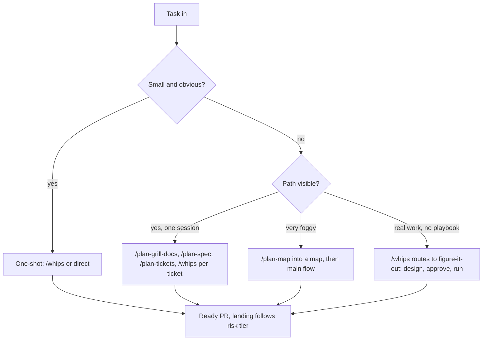
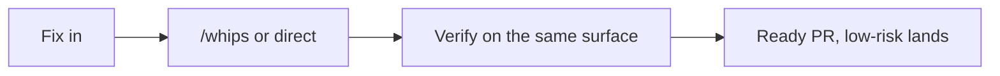
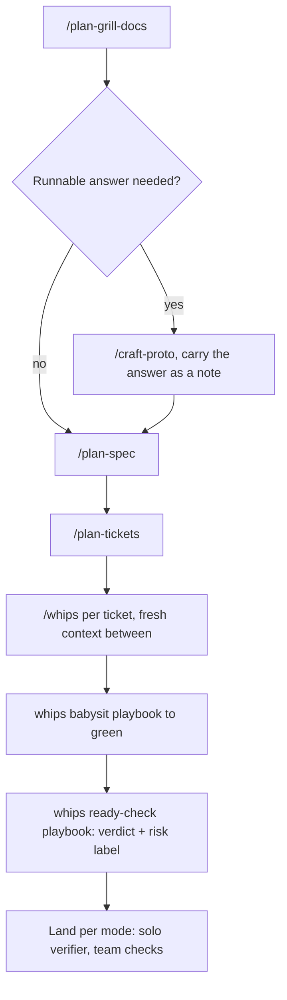
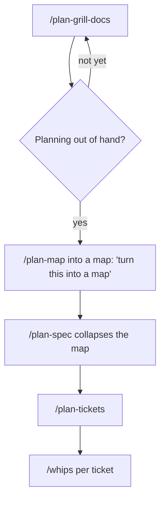
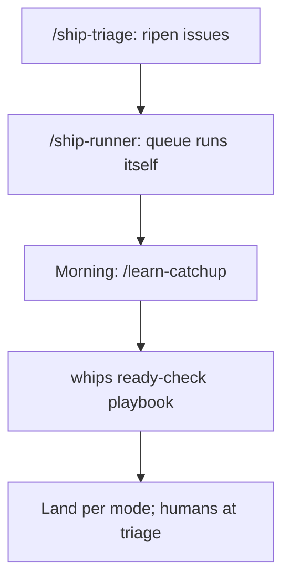

# Cookbook: flows and recipes

Each recipe is one complete workflow: when to use it, which skills to type in order, and its diagram. Diagrams render in preview. The interactive router stays in [`SKILL.md`](./SKILL.md); this book is for reading directly. For the big picture, read [FACTORY.md](./FACTORY.md).

Conventions in every diagram: boxes are skills you type (`/whips`) or playbooks whips runs, diamonds are your decisions, dashed arrows are escalations.

## 0. Which path (master map)

Thin fog skips the hops: when one interview round settles it in a fresh context, `/whips` drives through interview, spec sketch, and tickets inline (drive-through policy) instead of changing sessions.

## 1. Tiny fix one-shot

When: one line, a symlink, a config flag, a copy typo.

No interview: it costs more than the work.

Example: dead `public/storage` symlink. Type into `/whips`: "re-link public/storage to storage/app/public, verify with ls -l". One low-risk PR, lands directly.

## 2. Idea to ship (main flow)

When: an idea to build within one session or a few tickets.

One unbroken window for grill through tickets; each whips run starts fresh. Thin fog skips the hops via drive-through (recipe 0). Gate to a dedicated session only when the fog needs its own window.

Spec and tickets already exist: skip straight to `/whips` per ticket, blockers-first along the frontier, fresh context (and `/clear`) between tickets. Tracker issues with `ready-for-agent`: `/whips` intake interactively, `/ship-runner` unattended.

Example: "skeleton loading on the Menu page". `/plan-grill-docs` decides one reusable Skeleton component (not one per page), `/plan-spec`, `/plan-tickets` (3 tickets: component, use in Menu, e2e proof), `/whips` per ticket.

Upstream split: pstack owns automation and shipping, Matt owns planning ideas ([upstream-map.md](../../../docs/upstream-map.md)).

## 3. Foggy to map

When: greenfield or a giant feature with no visible path.

Never start with plan-map: a map and tickets you turn out not to need are self-made garbage. And thin fog never reaches it: drive-through inside whips handles what one interview round settles.

Example: "migrate media uploads to S3". Start `/plan-grill-docs`; planning sprawls into cost, rollback, seeders, so type "`/plan-map` let's turn this into a map" → map of decision tickets → `/plan-spec` collapses the map → tickets → whips.

## 4. Overnight unattended

When: sleep while the queue resolves itself.

Alternative for one long unattended run: `/whips` with a checkable predicate plus budget, not a queue. Execute stays `/whips` only.

Example: 5 `ready-for-agent` issues → `/ship-runner` on schedule → morning `/learn-catchup` ("2 action items: land solo batch, triage Seeder") → whips ready-check playbook via `/whips` → land per mode, humans at triage.

## FAQ

For the full catalog of skills, see the skill sections in [README.md](../../../README.md). Each answer below is one pointer; the owning skill holds the detail.

**Issues exist but carry no labels?** → [`/ship-triage`](../ship-triage/SKILL.md) walks each issue to a triage role; roles in its SKILL.md.

**Labels already say `ready-for-agent`?** → `/whips` intake while you watch, [`/ship-runner`](../ship-runner/SKILL.md) while you sleep.

**Spec and tickets already exist?** → `/whips` per ticket, blockers-first (recipe 2).

**PRs green, which merges first?** → `/whips` with "check on PR X" or "merge plan" ([ready-check](../whips/playbooks/ready-check.md) verdicts, land per [RISK](../whips/RISK.md)).

**PRD in hand but the stack is undecided?** → [`/plan-grill-docs`](../plan-grill-docs/SKILL.md) to settle it, then the main flow (recipe 2).

**MVP scoped but deploy target unknown?** → `/plan-grill-docs` for constraints plus [`/craft-research`](../../model-invoked/craft-research/SKILL.md) for platform facts, decided into an ADR.

**Sharpening a task or ticket before a run?** → [`/plan-sharpen`](../plan-sharpen/SKILL.md) for a brief, [`/plan-grill`](../plan-grill/SKILL.md) for a plan with no repo under it.

**Learning something over multiple sessions?** → [`/learn-teach`](../learn-teach/SKILL.md).

**Automating loops in your own life?** → [`/plan-worklog`](../plan-worklog/SKILL.md); repo-work checkpoints hand off to `/whips` or `/ship-runner`.

**Handed a project with no map?** → orient before building: [`craft-how`](../../model-invoked/craft-how/SKILL.md) walkthrough first, then [`/setup-repo`](../setup-repo/SKILL.md) when its output is missing.

**Setting up a repo for a mixed team?** → [`/setup-repo`](../setup-repo/SKILL.md) first: one tracker, one label vocabulary, frontier discipline.

**Monorepo built and developed together?** → [`/setup-repo`](../setup-repo/SKILL.md) multi-context (per-context glossaries).

**Starting TypeScript packages that import across each other?** → [`/setup-ts-modules`](../setup-ts-modules/SKILL.md) once, before agents start importing.

**Whole project still needs research across domains?** → one [`/craft-research`](../../model-invoked/craft-research/SKILL.md) per domain in parallel, then `/plan-grill-docs` to decide.

**No frontend design and no hassle wanted?** → `/whips` per ticket with "no design, keep one simple variant".

**Big decisions changed and meta docs went stale?** → [`/learn-retro`](../learn-retro/SKILL.md) contradiction pass, proposed first and written only on approval.

**Sessions lost, forgot what was done?** → reconstruct from ground truth (git log, tracker, docs as-is), then `/learn-retro` to resync.

**Starting fresh but recent work spans several chats?** → [`/learn-recall`](../learn-recall/SKILL.md): mines repo history plus session traces into a capsule brief.

**Multi-day program with one approval up front?** → [`figure-it-out`](../whips/playbooks/figure-it-out.md) for the designed phase list, then `/ship-runner` or one unattended run to execute.

**Must AFK with a deadline near, parallel tickets, no QA time?** → frontier tickets to `/ship-runner` before leaving; morning [`/learn-catchup`](../learn-catchup/SKILL.md) plus ready-check via `/whips`.

**Overnight run missed the spec, start over?** → no: `/learn-catchup`, check the Spec axis, then `/whips` pickup with the spec plus the missed point.

**Frontend refactor with a stack change, design stays?** → [`visual-parity`](../whips/playbooks/visual-parity.md): baseline first, zero diff to pass.

**Stack plus design both change?** → new UI, not a migration: `/whips` ui/feature with the new design as the spec.

**Screenshots requested, can they be automated?** → yes: `agent-browser` drives the flow and captures screenshots, video, and timeline pages; [`/ship-pr`](../../model-invoked/ship-pr/SKILL.md) attaches them to the PR.

**Deploy to hosting with no SSH, scripts ready, env left to fill?** → [`craft-wizard`](../../model-invoked/craft-wizard/SKILL.md) walks you through the human gate.

**Lost or behind?** → [`/learn-catchup`](../learn-catchup/SKILL.md) for news since your last message, [`/learn-catchup-video`](../learn-catchup-video/SKILL.md) to watch it, [`/learn-restate`](../learn-restate/SKILL.md) for one confusing message.

**Session over, make the environment better?** → [`/learn-retro`](../learn-retro/SKILL.md) fixes the repo, [`/learn-reflect`](../learn-reflect/SKILL.md) writes learnings back into skills.

**Spare moment, shallow modules keep hurting?** → [`/craft-deepen`](../craft-deepen/SKILL.md) scans and proposes one deep module; interview settles the seam; `/whips` refactor extracts it.

**Slow path with a number to defend?** → [`perf-issue`](../whips/playbooks/perf-issue.md) baselines, [`hillclimb`](../whips/playbooks/hillclimb.md) iterates; a number without limiter, run count, and spread is not evidence (see [`verify-bench`](../../model-invoked/verify-bench/SKILL.md)).

**UI change needing proof?** → [`/craft-break`](../../model-invoked/craft-break/SKILL.md) stress on a throwaway page, then `/whips` ui; long video gets a [`craft-ui-timeline`](../../model-invoked/craft-ui-timeline/SKILL.md) page.
