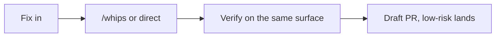
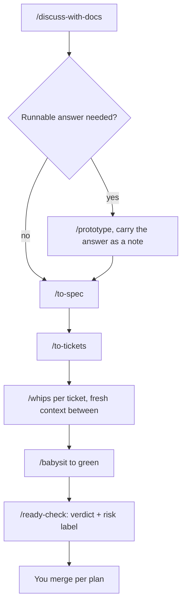
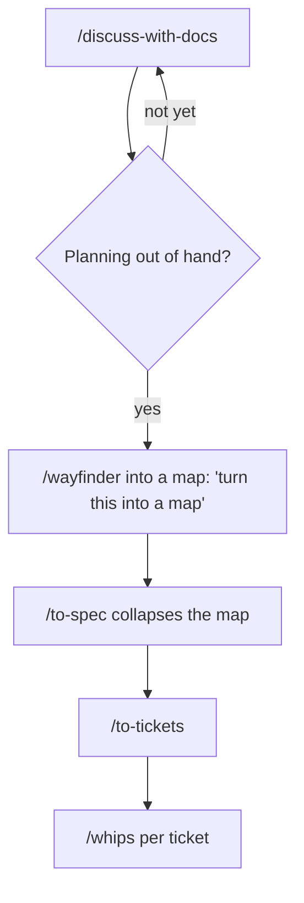
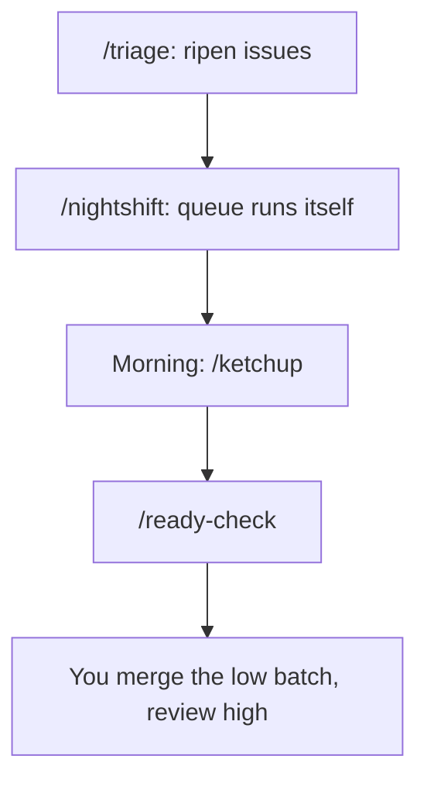
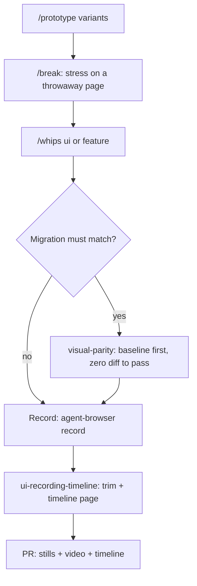
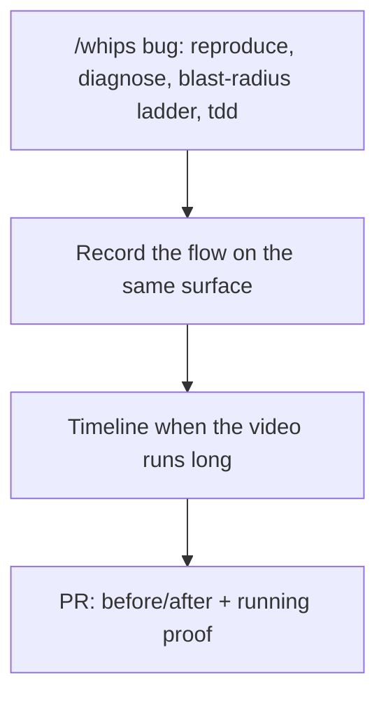
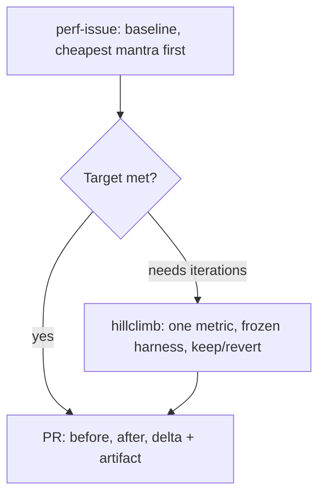
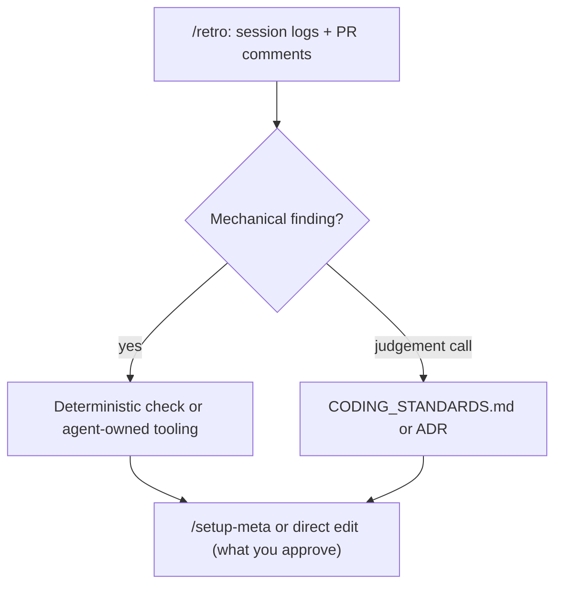
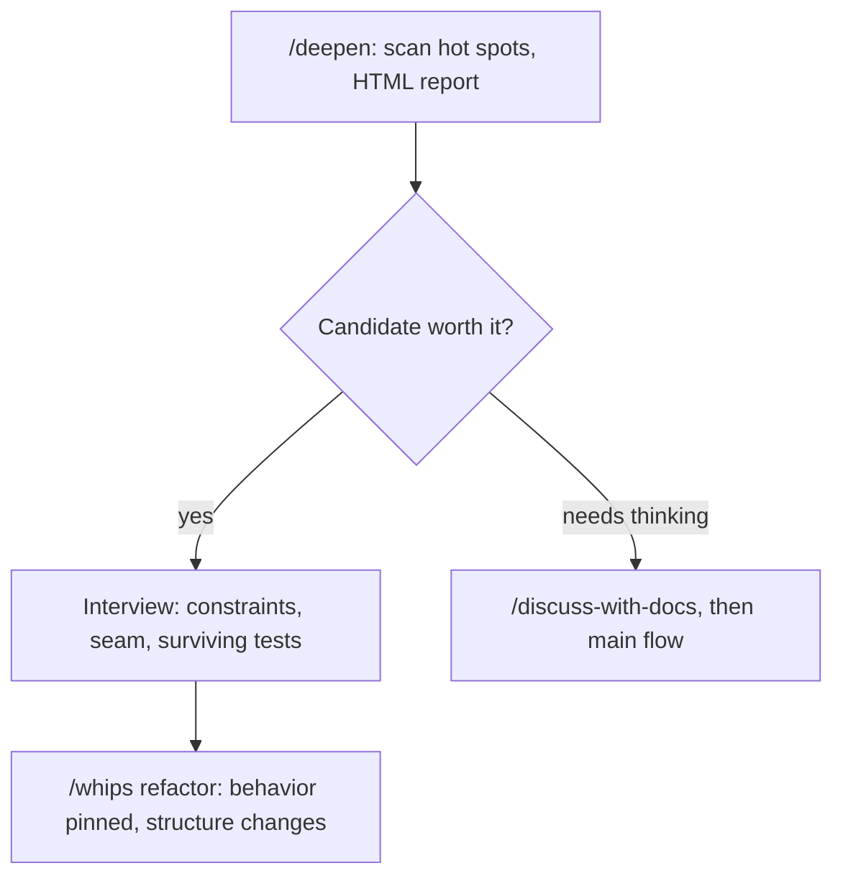

# Cookbook: flows and recipes

Each recipe is one complete workflow: when to use it, which skills to type in order, and its diagram. Diagrams render in preview. The interactive router stays in [`SKILL.md`](./SKILL.md); this book is for reading directly.

Conventions in every diagram: boxes are skills you type (`/whips`) or playbooks whips runs, diamonds are your decisions, dashed arrows are escalations. Every recipe closes with a real example from recent CMS work.

## 0. Which path (master map)

## 1. Tiny fix one-shot

When: one line, a symlink, a config flag, a copy typo.

No interview: it costs more than the work.

Example: dead `public/storage` symlink. Type into `/whips`: "re-link public/storage to storage/app/public, verify with ls -l". One low-risk PR, lands directly.

## 2. Idea to ship (main flow)

When: an idea to build within one session or a few tickets.

One unbroken window for discuss through tickets; each whips run starts fresh.

Example: "skeleton loading on the Menu page". `/discuss-with-docs` decides one reusable Skeleton component (not one per page), `/to-spec`, `/to-tickets` (3 tickets: component, use in Menu, e2e proof), `/whips` per ticket.

## 3. Foggy to map

When: greenfield or a giant feature with no visible path.

Never start with wayfinder: a map and tickets you turn out not to need are self-made garbage.

Example: "migrate media uploads to S3". Start `/discuss-with-docs`; planning sprawls into cost, rollback, seeders, so type "`/wayfinder` let's turn this into a map" → map of decision tickets → `/to-spec` collapses the map → tickets → whips.

## 4. Overnight unattended

When: sleep while the queue resolves itself.

Alternative for one long task: `/whips` autonomous-run with predicate + budget, not a queue.

Example: 5 `ready-for-agent` issues → `/nightshift` before sleep → morning `/ketchup` ("2 action items: merge low batch, review Seeder high") → `/ready-check` → merge the low batch, review high.

## 5. UI change with proof

When: interface changes, migrations that must stay pixel-identical. Example: promo modal copy must match the PNG verbatim. `/whips` ui, screenshot @740px crop native 1x, compare against modal-promo.png, PR before/after pair; full migrations use visual-parity (baseline first, zero diff to pass).

## 6. Bug with browser proof

When: defects that need proof by running, not by writing.

A writeup that sounds right is worthless without the run.

Example: BUG-02 upload stuck at 100%. `/whips` bug (repro in /admin, root cause in middleware, regression test), record the 151-second flow, `trim` to the upload-save-reload scenes, timeline page, PR before/after + video + timeline.

## 7. Perf number to PR

When: a slow path with a number to defend.

A number without limiter, run count, and spread is not evidence (rule 19).

Example: menu N+1 query, p95 2.1s, target under 500ms. `perf-issue` (baseline + "do it less" mantra: eager load); not enough, so `hillclimb` (p95 metric, frozen median-of-7 harness, 6 iterations 2 kept); PR cites numbers + artifact.

## 8. Lost or behind

When: the chat outran you, or one agent message does not land.

- Behind on news: `/ketchup` (everything since your last message + executive summary per action item).
- Confused by one message: `/wait-what` (visual re-pitch + plain sentences).
- Both run mid-conversation inside other skills.

Example: morning after a 5-issue nightshift, `/ketchup` answers "2 action items: merge low batch (link), review Seeder high (summary + recommendation)". One confusing message mid-flow, `/wait-what` re-pitches it visually.

## 9. Close the loop

When: session over, the environment must be better than before it started.

A repeated manual task becomes a CLI + skill candidate (fewer tokens, fewer hallucinations).

Example: the image-rescue PR was born because proof URLs died with branch deletion. The recurring "rotten proof link" objection became the canonical-main-URL rule + `check-proof-urls.sh` (deterministic check, not prose). PR comments inform the code going forward.

## 10. Deslop the codebase

When: spare moment, hot spots keep hurting, new code copies old shallow shapes.

Scope before you scan (YAGNI): recently changed areas first. Unslop cleans prose; deepen cleans structure.

Example: navbar variants scattered across 4 files, same assumption repeated. `/deepen` proposes one deep Navbar module; interview settles the seam; `/whips` refactor extracts it with behavior pinned.
