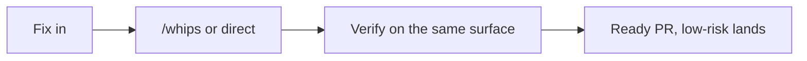
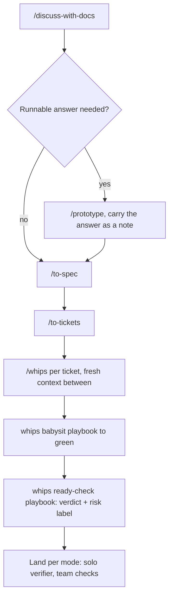
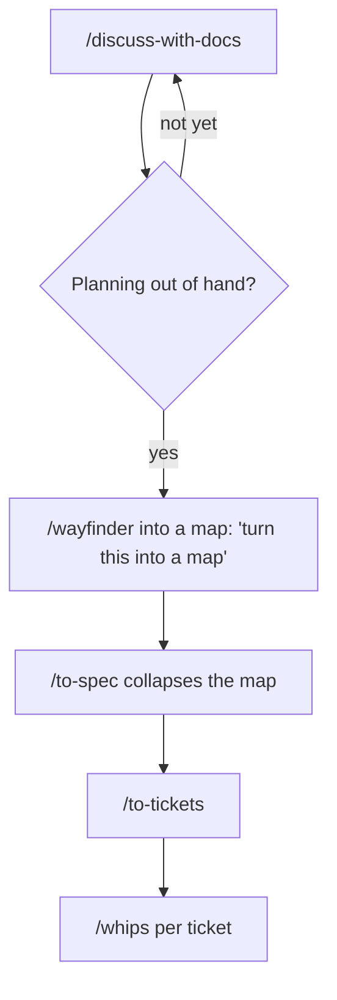
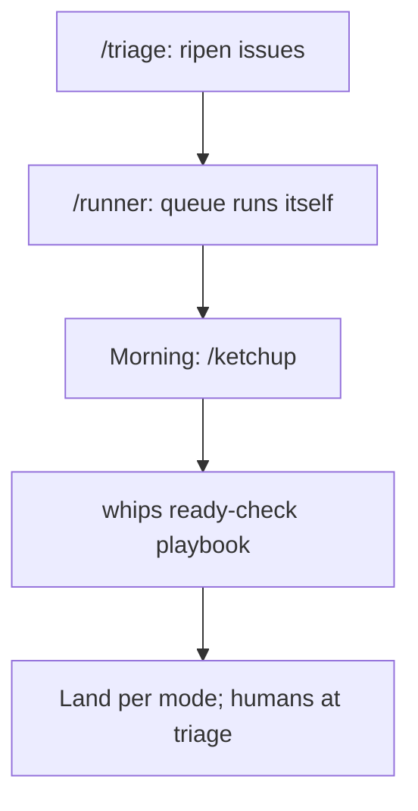
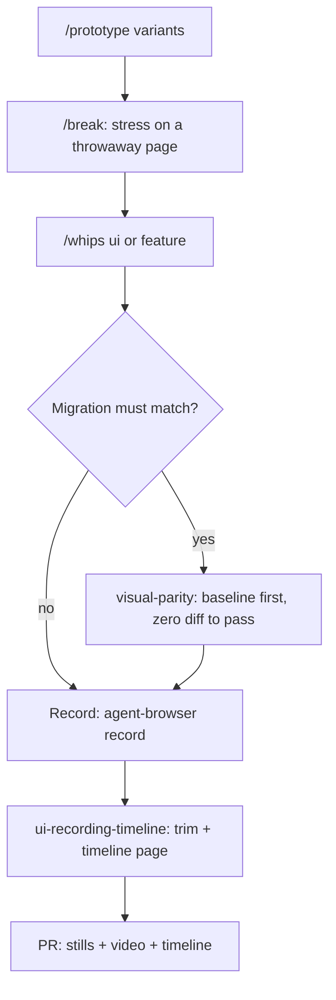
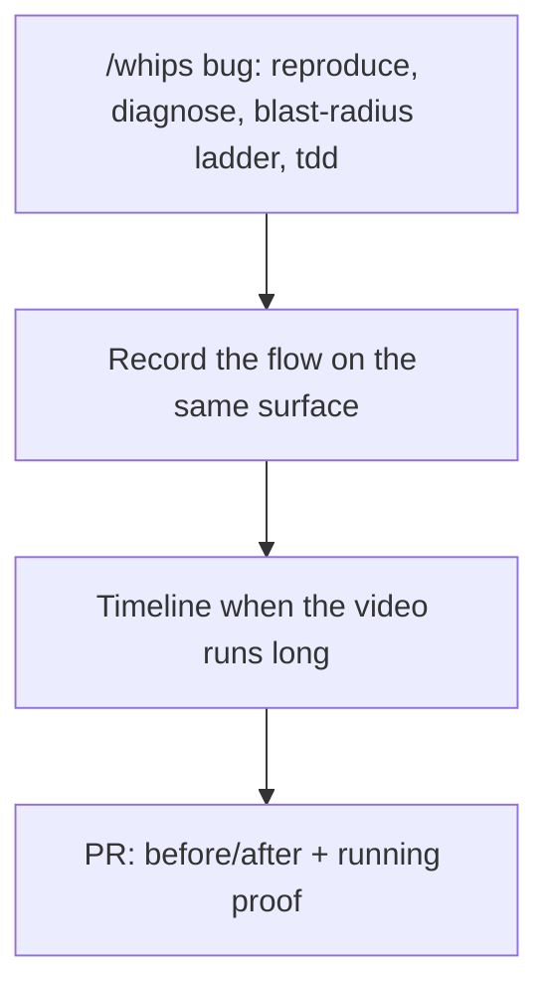
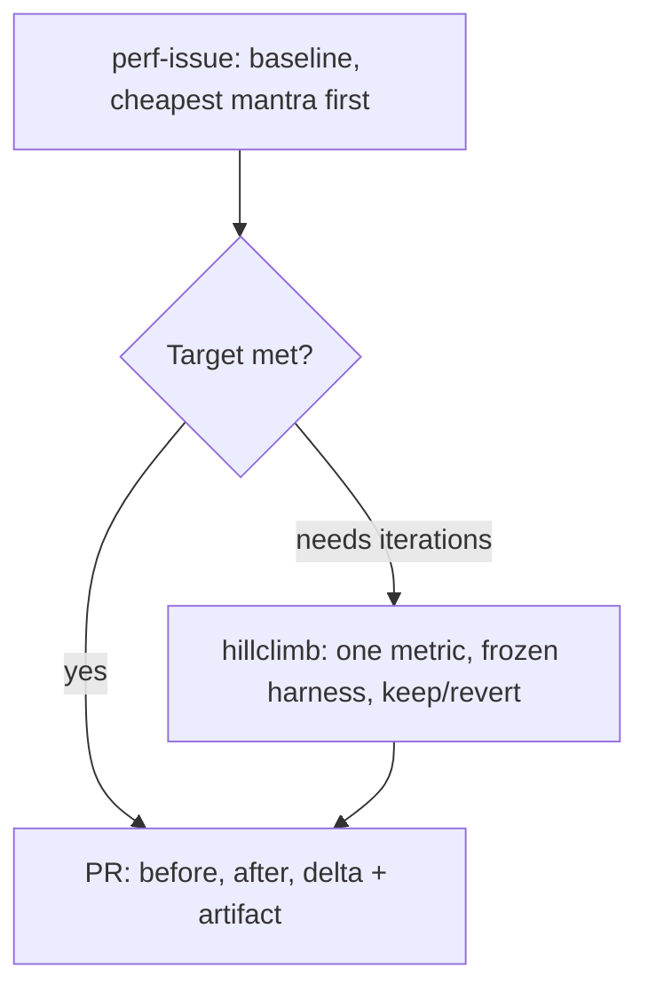
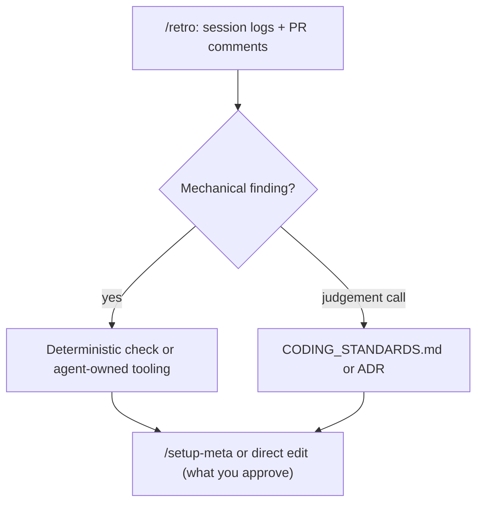
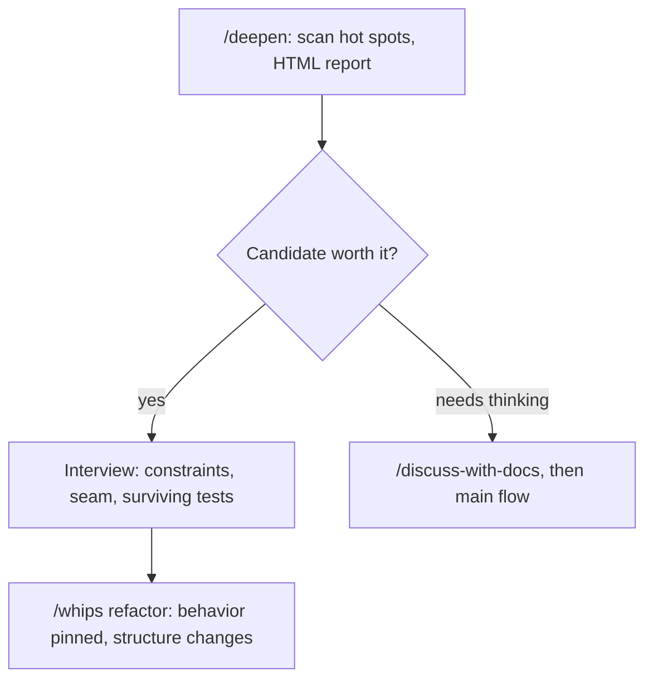

# Cookbook: flows and recipes

Each recipe is one complete workflow: when to use it, which skills to type in order, and its diagram. Diagrams render in preview. The interactive router stays in [`SKILL.md`](./SKILL.md); this book is for reading directly. For the map of why this all works, read [FACTORY.md](./FACTORY.md).

Conventions in every diagram: boxes are skills you type (`/whips`) or playbooks whips runs, diamonds are your decisions, dashed arrows are escalations. Every recipe closes with a real example drawn from recent work across frontend, backend, and docs domains.

## 0. Which path (master map)

Thin fog skips the hops: when one interview round settles it in a fresh context, `/whips` drives through interview, spec sketch, and tickets inline (drive-through policy) instead of changing sessions.

## 1. Tiny fix one-shot

When: one line, a symlink, a config flag, a copy typo.

No interview: it costs more than the work.

Example: dead `public/storage` symlink. Type into `/whips`: "re-link public/storage to storage/app/public, verify with ls -l". One low-risk PR, lands directly.

## 2. Idea to ship (main flow)

When: an idea to build within one session or a few tickets.

One unbroken window for discuss through tickets; each whips run starts fresh. Thin fog skips the hops via drive-through (recipe 0). Gate to a dedicated session only when the fog needs its own window.

Spec and tickets already exist: skip straight to `/whips` per ticket, blockers-first along the frontier, fresh context (and `/clear`) between tickets. Tracker issues with `ready-for-agent`: `/whips` intake interactively, `/runner` unattended.

Example: "skeleton loading on the Menu page". `/discuss-with-docs` decides one reusable Skeleton component (not one per page), `/to-spec`, `/to-tickets` (3 tickets: component, use in Menu, e2e proof), `/whips` per ticket.

## 3. Foggy to map

When: greenfield or a giant feature with no visible path.

Never start with wayfinder: a map and tickets you turn out not to need are self-made garbage. And thin fog never reaches it: drive-through inside whips handles what one interview round settles.

Example: "migrate media uploads to S3". Start `/discuss-with-docs`; planning sprawls into cost, rollback, seeders, so type "`/wayfinder` let's turn this into a map" → map of decision tickets → `/to-spec` collapses the map → tickets → whips.

## 4. Overnight unattended

When: sleep while the queue resolves itself.

Alternative for one long unattended run: `/whips` with a checkable predicate plus budget, not a queue. A queue of independent PRs with one owner each runs through the whips `autopilot-full` playbook (or `autopilot-stack` when the operator holds landing); `/runner` stays the pick for `ready-for-agent` issue intake on a schedule.

Example: 5 `ready-for-agent` issues → `/runner` on schedule → morning `/ketchup` ("2 action items: land solo batch, triage Seeder") → whips ready-check playbook via `/whips` → land per mode, humans at triage.

## 5. UI change with proof

When: interface changes, migrations that must stay pixel-identical. Example: promo modal copy must match the PNG verbatim. `/whips` ui, screenshot @740px crop native 1x, compare against modal-promo.png, PR before/after pair; full migrations use visual-parity (baseline first, zero diff to pass).

## 6. Bug with browser proof

When: defects that need proof by running, not by writing.

A writeup that sounds right is worthless without the run.

Example: BUG-02 upload stuck at 100%. `/whips` bug (repro in /admin, root cause in middleware, regression test), record the 151-second flow, `trim` to the upload-save-reload scenes, timeline page, PR before/after + video + timeline.

## 7. Perf number to PR

When: a slow path with a number to defend.

A number without limiter, run count, and spread is not evidence (rule 19).

Example: menu N+1 query, p95 2.1s, target under 500ms. `perf-issue` (baseline + "do it less" mantra: eager load); not enough, so `hillclimb` (p95 metric, frozen median-of-7 harness, 6 iterations 2 kept); PR cites numbers + artifact.

## 8. Lost or behind

When: the chat outran you, or one agent message does not land.

- Behind on news: `/ketchup` (everything since your last message + executive summary per action item).
- Confused by one message: `/wait-what` (visual re-pitch + plain sentences).
- Both run mid-conversation inside other skills.

Example: morning after a 5-issue runner queue, `/ketchup` answers "2 action items: land solo batch (link), triage Seeder (summary + recommendation)". One confusing message mid-flow, `/wait-what` re-pitches it visually.

## 9. Close the loop

When: session over, the environment must be better than before it started. Run it after successes too: a smooth session still hides inefficiencies and workarounds the agent battled silently. Pick the loop by what should change: `/reflect` writes learnings back into skills, `/retro` fixes the repo environment (checks, docs, pointers), `/ketchup` changes nothing and just catches you up.

A repeated manual task becomes a CLI + skill candidate (fewer tokens, fewer hallucinations). Whips runs feed this loop with one strategic-track nomination each. Every few sessions, point retro at the last 10 for navigability: slow finds and trusted-but-stale docs are the cheapest tokens you will ever save. When the finding belongs in a skill instead (a gap in a skill you used, or one that should have fired but did not), say `/reflect`: three reviewers mine this session and each accepted learning becomes a small skill PR. `/ketchup` is the odd one out: same-session catch-up with action items, no writes at all.

Example: the image-rescue PR was born because proof URLs died with branch deletion. The recurring "rotten proof link" objection became the canonical-main-URL rule + `check-proof-urls.sh` (deterministic check, not prose). PR comments inform the code going forward.

## 10. Deslop the codebase

When: spare moment, hot spots keep hurting, new code copies old shallow shapes.

Scope before you scan (YAGNI): recently changed areas first. Unslop cleans prose; deepen cleans structure.

Example: navbar variants scattered across 4 files, same assumption repeated. `/deepen` proposes one deep Navbar module; interview settles the seam; `/whips` refactor extracts it with behavior pinned.

## FAQ

**Issues exist but carry no labels?** → `/triage`. Unlabeled is its first bucket: it evaluates, verifies the claim, interviews when needed, and walks each issue to `ready-for-agent`, `ready-for-human`, or `wontfix`.

**Labels already say `ready-for-agent`?** → `/whips` intake while you watch, `/runner` while you sleep.

**Spec and tickets already exist?** → `/whips` per ticket, blockers-first (recipe 2).

**PRs green, which merges first?** → `/whips` with "check on PR X" or "merge plan": the ready-check playbook verifies each independently and orders the plan by risk and mode (solo verifier, team checks).

**Empty repo with PRD.md but confused about the stack?** → `/discuss-with-docs` first: settle backend/frontend (spike with `/prototype` when running code can answer the fork), record the stack as an ADR (hard-to-reverse by definition), seed `GLOSSARY.md`. Then `/setup-meta` (tracker, docs, standards), `/to-spec` built from the PRD, `/to-tickets`, `/whips` per ticket.

**MVP scoped but deploy target unknown?** → `/discuss-with-docs` for constraints (budget, traffic, region, ops appetite) plus `/research` for platform facts, decided into an ADR. Deploy wiring itself is repo work: `/whips` feature once the target is locked.

**Sharpening a task or ticket before a run?** → `/sharpen`: deeper, not bigger, then a rewritten prompt. **Sharpening a plan with no repo under it?** → `/discuss` (stateless interview, saves nothing). In a working directory, `/discuss-with-docs` instead: same interview plus the paper trail.

**Learning something over multiple sessions?** → `/teach`: mission, lessons, and reference sheets in a stateful workspace, paced to your zone of proximal development. Not repo work, not a flow step.

**Automating loops in your own life?** → `/worklog`: interview your mornings, inboxes, and weekly reviews into workflow specs in `workflows/*.md`. When a spec's implementation is repo work, its checkpoint brief hands off to `/whips` or `/runner`.

**Handed a project with no map, unknown codebase, told to build a feature?** → orient before building, never blind. `how` walkthrough first (Where Things Live: modules, seams, data flow), check the `setup-meta` output exists (run it when missing: tracker, labels, glossary, standards). After `/setup-meta`, read `docs/agents/docs-layout.md` for where skills write and read. Then `/whips` feature: its Map gate refuses vague maps, so exploration lands before any implementation.

**Setting up a repo for a mixed team (agents, programmers, a PM) with frontend and backend tickets?** → `/setup-meta` first so everyone shares one tracker and one label vocabulary (states mean the same to humans and agents). Scope via `/to-spec` or `/discuss-with-docs`, then `/to-tickets` with blocking edges across frontend and backend: anyone (agent or programmer) grabs frontier tickets whose blockers are done, claiming by assignment. The PM runs `/triage` for queue hygiene (needs-info interviews, `ready-for-agent` when a brief is truly agent-ready). One tracker, one vocabulary, frontier discipline.

**Monorepo built and developed together?** → `/setup-meta` multi-context (root `GLOSSARY-MAP.md` plus one glossary per context, shared domain terms so packages agree on words).

**When is `setup-ts-deep-modules` used?** → once, at the start of a TypeScript multi-package repo (or when imports already tangle across packages): it wires dependency-cruiser so every package exposes only root entry points with implementation hidden in subfolders, proves the rules bite (pass, fail on a deep import, pass), and writes the packages README plus the `AGENTS.md` pointer. Run it before agents start importing, not after the tangle. Tickets declare cross-package blocking edges; contracts and shared types land first, consumers follow. Each unit builds in its own worktree and branch; TypeScript packages get deep-module boundaries via `setup-ts-deep-modules`. One root verifier running every package's checks.

**Whole project still needs research across domains?** → fan out one `/research` per domain in parallel (frontend tech, backend tech, deploy target); each leaves a cited findings file while you keep working. Then `/discuss-with-docs` to decide (one ADR per hard call). Project-scale fog instead: `/wayfinder`, which runs each domain as a research ticket and resolves them in parallel before the map clears.

**Tickets ready and MVP clear, but no frontend design and no hassle wanted?** → nothing left to decide: `/whips` per ticket, blockers-first. Say "no design, keep one simple variant" so frontend tickets skip variant-diverge and build functional UI from the `DESIGN.md` tokens. No `DESIGN.md` yet → `/setup-meta` Section D scaffolds tokens from brand notes first, once.

**Big decisions changed and meta docs went stale?** → `/retro` step 4: contradiction/unused/gap pass over `GLOSSARY.md`, ADRs, `DESIGN.md`, `CODING_STANDARDS.md`, and `AGENTS.md` pointers, proposed first and written only on approval. Small terminology or single-decision updates skip retro: `/discuss-with-docs` or `/domain-modeling` inline.

**Sessions lost, forgot what was done, meta docs look stale?** → reconstruct from ground truth first (git log, issue tracker, the docs as-is), then `/retro` to resync the docs to reality.

**Starting fresh but recent work spans several chats?** → `/recall`: scope the window, mine repo history plus session traces, verify live, capsule brief with tagged threads. One specific run or branch is whips pickup; this chat alone is `/ketchup`. Going forward, keep decisions in ADRs and tickets so memory lives in the repo, not in sessions. No skill recovers what was never written down.

**Multi-day program with one approval up front?** → `figure-it-out` for the designed phase list (approve once), `runner` or a single unattended run to execute, scheduled `ready-check` to land qualifying batches. Humans decide at triage; the design approval plus tiered verification carry the rest.

**Must AFK with a deadline near, parallel tickets, no QA time?** → split first: frontier tickets (behavior already answers every open question) run now; tickets genuinely needing you wait with an explicit "needs decision X" note. Frontier goes to `/runner` before you leave (fresh worktree each, ready PRs only, set max-issues). QA does not vanish, it compacts: per-slice tests plus verification evidence ride in each PR, and your morning is `/ketchup` plus the whips ready-check playbook via `/whips` (independent verdicts, land per mode, humans at triage). Decisions the requested behavior already answers are not decisions: say so in the ticket and let them run.

**Overnight run missed the spec, start over in a new session?** → no. Morning `/ketchup`, then check the Spec axis (`/code-review` Standards + Spec, or the ready-check verdict). Then `/whips` pickup on the open PR with the spec plus the missed point: small miss means a fix round on the same PR, big miss means a fresh ticket. Either way it runs fresh by design, never as a resume-chain of the night session.

**Frontend refactor with a stack change, design stays?** → `visual-parity`: screenshot baseline first (blocking prerequisite), migrate component by component, zero image diff to pass, behavior pinned throughout. Same look, new guts.

**Stack plus design both change?** → new UI, not a migration: `/whips` ui/feature with the new design as the spec, `DESIGN.md` tokens updated alongside (setup-meta Section D or direct edit). Prototype variants only when the look is genuinely open; a decided design builds straight.

**Screenshots requested, can they be automated?** → yes, end to end: `agent-browser` drives the flow and captures screenshots, video, and timeline pages; the visual-parity baseline harness screenshots every state; the `pr` skill attaches them (pair table, video, timeline link). The only human fallback: when `agent-browser` is not installed in the environment, the agent names the missing pairs and the human captures them by hand.

**Deploy to hosting with no SSH or MCP (cPanel FTP + terminal only), scripts ready, env left to fill?** → wizard (model-invoked, via the Skill tool). No SSH means the agent cannot reach the server, so deploying is a human gate by definition: the agent prepares everything preparable (build artifact, env template with empty values, ordered checklist) and the wizard walks you through uploading via FTP, filling env in the cPanel terminal, and verifying live. One run, no re-explaining next time.
