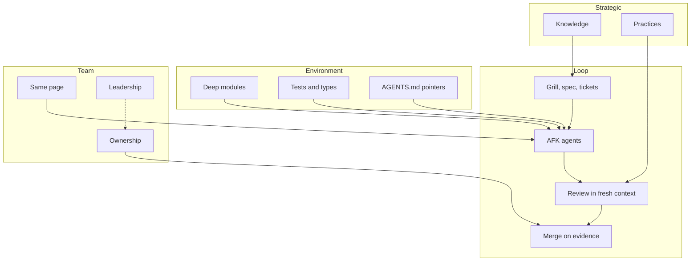
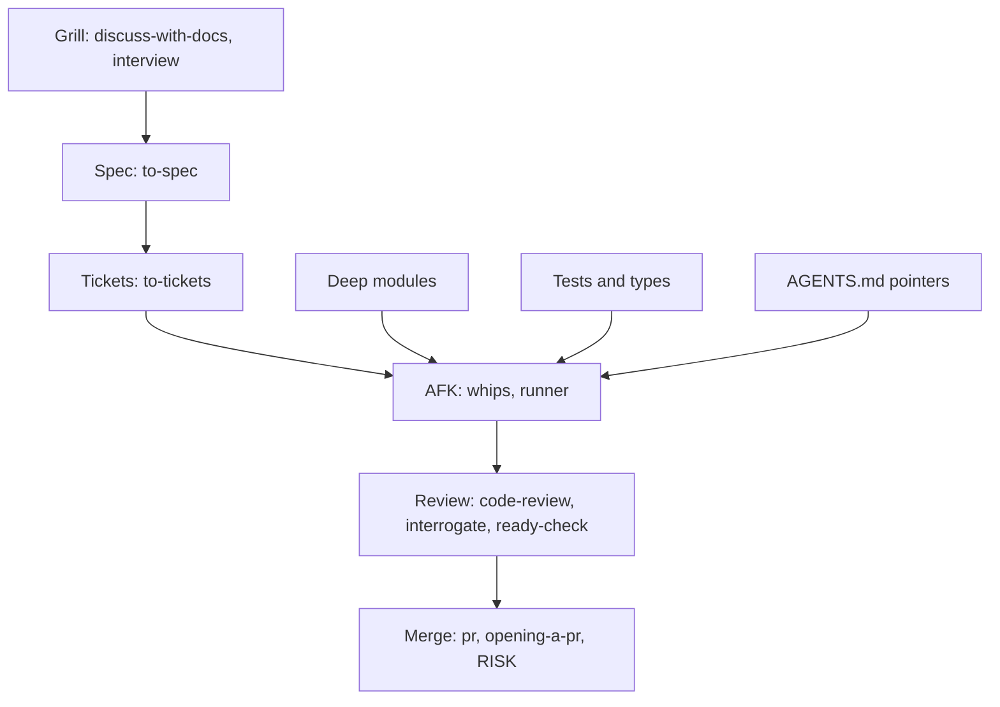
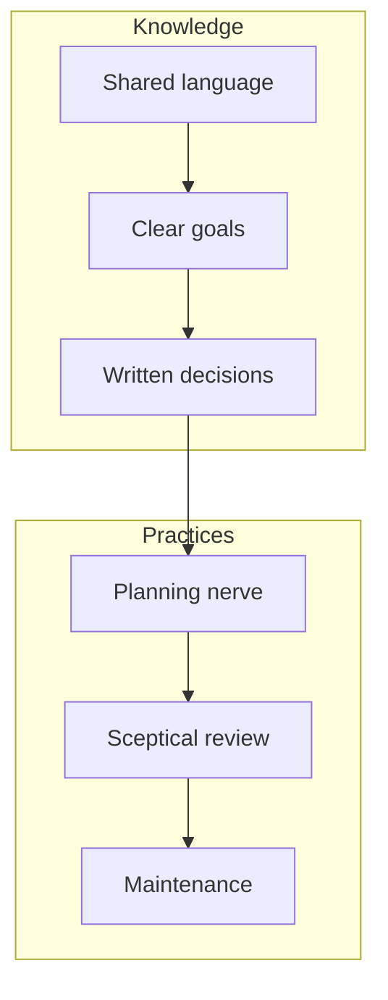
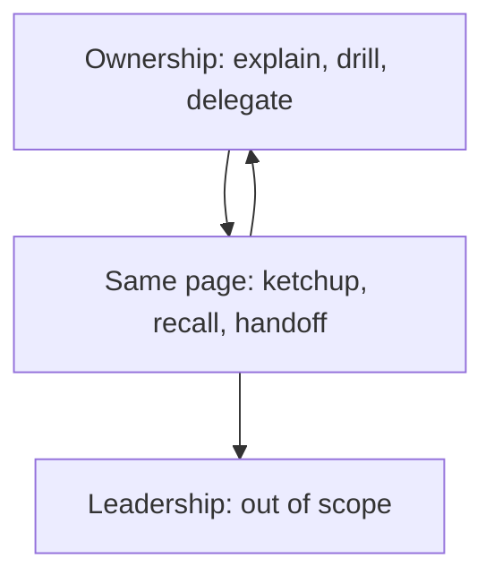

# Factory: how this repo works layer by layer

Credit: map after Matt Pocock, see [CREDITS.md](./CREDITS.md).

## TL;DR

This repo turns a vague idea into a reviewed ready PR through one fixed factory: map first, guardrails second, then small walked tickets. Agents run AFK inside that loop with fresh context per ticket, and every claim leaves proof in the PR. Strategy and team layers keep the loop honest: shared language, written decisions, sceptical review, and ownership of each diff. Solo repos land on the local verifier, team repos on required checks; risk tiers add verification (fresh-context run, blast-radius, adversarial review) where the blast radius earns it.

## Overview

## Loop and environment

| Box | In this repo | Skill or playbook | Status |
| --- | --- | --- | --- |
| Grill, spec, tickets | Grill with docs, interview primitive, spec, tickets, wayfinder for fog | [discuss-with-docs](../discuss-with-docs/SKILL.md), [interview](../../model-invoked/interview/SKILL.md), [to-spec](../to-spec/SKILL.md), [to-tickets](../to-tickets/SKILL.md), [wayfinder](../wayfinder/SKILL.md) | ada |
| AFK agents | Whips routes each unit, runner works queues on schedule, autopilot owners carry one PR each to MERGED (or hold the stack for the operator), swarm fans out parallel work | [whips](../whips/SKILL.md), [orchestrate](../whips/playbooks/orchestrate.md), [autopilot-full](../whips/playbooks/autopilot-full.md), [autopilot-stack](../whips/playbooks/autopilot-stack.md), [pickup](../whips/playbooks/pickup.md), [pause](../whips/playbooks/pause.md), [runner](../runner/SKILL.md), [swarm](../../model-invoked/swarm/SKILL.md) | ada |
| Review in a fresh context | Two-axis review, adversarial review, independent ready-check verdict, clear context between tickets | [code-review](../../model-invoked/code-review/SKILL.md), [interrogate](../../model-invoked/interrogate/SKILL.md), [ready-check](../whips/playbooks/ready-check.md), [guide](./SKILL.md) | ada |
| Merge on evidence | PR body with proof, opening checklist, risk tier, proof URL check | [pr](../../model-invoked/pr/SKILL.md), [opening-a-pr](../whips/playbooks/opening-a-pr.md), [ready-check](../whips/playbooks/ready-check.md), [RISK](../whips/RISK.md) | ada |
| Deep modules | Shared vocabulary, scan for shallow modules, one-time TypeScript wiring, settle shape before code | [codebase-design](../../model-invoked/codebase-design/SKILL.md), [deepen](../deepen/SKILL.md), [setup-ts-deep-modules](../setup-ts-deep-modules/SKILL.md), [architect](../../model-invoked/architect/SKILL.md) | ada |
| Tests and types as feedback loops | Red-green refactor, hooks and checks, generated verification skill, upkeep, formal checks where tests cannot reach, tight diagnose loop, blast radius check | [tdd](../../model-invoked/tdd/SKILL.md), [setup-pre-commit](../../model-invoked/setup-pre-commit/SKILL.md), [create-verification](../create-verification/SKILL.md), [maintain-verification](../maintain-verification/SKILL.md), [create-formal-verification](../create-formal-verification/SKILL.md), [maintain-formal-verification](../maintain-formal-verification/SKILL.md), [statechart](../statechart/SKILL.md), [diagnose](../../model-invoked/diagnose/SKILL.md), [blast-radius](../../model-invoked/blast-radius/SKILL.md) | ada |
| AGENTS.md as an index of pointers | Repo [AGENTS.md](../../../AGENTS.md) is a pointer index into [.agents/](../../../.agents/) | [writing-for-agents](../../model-invoked/writing-for-agents/SKILL.md), [setup-meta](../setup-meta/SKILL.md) | ada |

## Strategic layer

| Box | In this repo | Skill or playbook | Status |
| --- | --- | --- | --- |
| One shared language | Glossary habit plus domain modeling inside doc interviews, re-pitch when a message misses | [domain-modeling](../../model-invoked/domain-modeling/SKILL.md), [discuss-with-docs](../discuss-with-docs/SKILL.md), [wait-what](../wait-what/SKILL.md) | ada |
| Clear goals | Goal restated before playbook match, sharpened brief, spec | [whips](../whips/SKILL.md), [sharpen](../sharpen/SKILL.md), [to-spec](../to-spec/SKILL.md) | ada |
| Decisions written down | ADRs under .agents/adr, paper trail interviews, decision trail, map decisions, personal loops | [discuss-with-docs](../discuss-with-docs/SKILL.md), [show-me-your-work](../../model-invoked/show-me-your-work/SKILL.md), [wayfinder](../wayfinder/SKILL.md), [worklog](../worklog/SKILL.md) | ada |
| Planning nerve | One-shot versus grill versus wayfinder rule, recipes 1 and 3, figure-it-out for work with no playbook | [guide](./SKILL.md), [COOKBOOK](./COOKBOOK.md), [figure-it-out](../whips/playbooks/figure-it-out.md) | ada |
| Sceptical review | Adversarial review, two-axis review, principles, stress page, number check before reporting | [interrogate](../../model-invoked/interrogate/SKILL.md), [code-review](../../model-invoked/code-review/SKILL.md), [PRINCIPLES](../whips/PRINCIPLES.md), [break](../../model-invoked/break/SKILL.md), [benchmark-checklist](../../model-invoked/benchmark-checklist/SKILL.md) | ada |
| Maintenance without blame | Retro states the blame-free rule, backed by the correction ladder, upkeep playbook, verification upkeep, and deslop passes; reflect routes session learnings back into skills | [retro](../retro/SKILL.md), [reflect](../reflect/SKILL.md), [correct](../../model-invoked/correct/SKILL.md), [upkeep](../whips/playbooks/upkeep.md), [maintain-verification](../maintain-verification/SKILL.md), [deepen](../deepen/SKILL.md), [no-comments](../../model-invoked/no-comments/SKILL.md) | ada |

## Team layer

| Box | In this repo | Skill or playbook | Status |
| --- | --- | --- | --- |
| Ownership | Learning gates (deprecated from merge path; `/teach` or `interview` for the value), learn while delegating, taste drills | [explain-diff-before-merge](../explain-diff-before-merge/SKILL.md) (deprecated 2026-10-31: not called from merge, ready-check, shipping, or opening-a-pr), [learn-while-delegating](../learn-while-delegating/SKILL.md), [judgment-drill](../judgment-drill/SKILL.md) | ada |
| On the same page | Catch-up, context rebuild, handoff note, demo, re-pitch | [ketchup](../ketchup/SKILL.md), [recall](../recall/SKILL.md), [handoff](../handoff/SKILL.md), [showcase](../showcase/SKILL.md), [wait-what](../wait-what/SKILL.md) | ada |
| Leadership that backs it | Solo repo with no org layer, so no skill covers it | | gap |

## Gap list

- **Leadership that backs it (gap):** team backing is an org concern and this repo ships for solo use. Suggestion: keep it out of scope, revisit only when a team adopts the repo.

## Next step

Read the router in [SKILL.md](./SKILL.md) when you want a skill picked for you, and the recipes in [COOKBOOK.md](./COOKBOOK.md) when you want the ordered steps.
