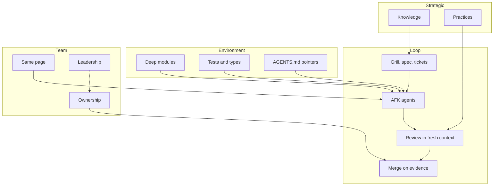

# Factory: how this repo works layer by layer

Credit: map after Matt Pocock, see [CREDITS.md](./CREDITS.md).

## TL;DR

This repo turns a vague idea into a reviewed ready PR through one fixed factory: map first, guardrails second, then small walked tickets. Agents run AFK inside that loop with fresh context per ticket, and every claim leaves proof in the PR. Strategy and team layers keep the loop honest: shared language, written decisions, sceptical review, and ownership of each diff. Solo repos land on the local verifier, team repos on required checks; risk tiers add verification where the blast radius earns it.

## Overview

## Where each box lives

This page states the shape; the detail lives at its source of truth, never copied here.

- Loop (grill, spec, tickets, AFK, review, merge): the skill sections in [README.md](../../../README.md), and [stage-pipeline.md](../whips/playbooks/stage-pipeline.md) for grill to execute stages.
- Local name to upstream for every box: [upstream-map.md](../../../docs/upstream-map.md).
- Principles behind sceptical review: [PRINCIPLES.md](../whips/PRINCIPLES.md) and the [principles](../../model-invoked/principles/SKILL.md) skill.
- Triage label roles: [ship-triage](../ship-triage/SKILL.md).
- Risk tiers and landing: [RISK.md](../whips/RISK.md) and [opening-a-pr.md](../whips/playbooks/opening-a-pr.md).

## Next step

Read the router in [SKILL.md](./SKILL.md) when you want a skill picked for you, and the recipes in [COOKBOOK.md](./COOKBOOK.md) when you want the ordered steps.
